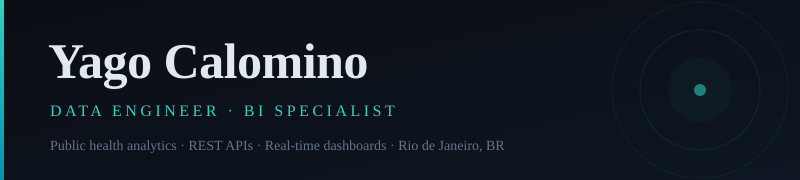

### Data & Analytics Engineer · Healthtech · Rio de Janeiro

SQL/BI work on production databases (PostgreSQL, Oracle, Firebird) at Medilab Sistemas,
a healthcare software company. Postgraduate student in Data Engineering. I build
pipelines that turn messy public-health data into dimensional models people can query.

**Featured: [HealthLens](https://github.com/YagoCalomino/HealthLens)**  ETL over Brazil's
DataSUS microdata (SIM, SIH, SINAN: 9.2M+ notifications), PostgreSQL star schema,
offline forecasting and clustering, FastAPI + React dashboard. [Live demo](https://health-lens-virid.vercel.app)

**Stack**
- Data: SQL (PostgreSQL, Oracle, Firebird), Python, pandas, Power BI (DAX/Power Query)
- Modeling: star schema, materialized views, Alembic migrations, query performance tuning
- Serving: FastAPI, Docker, GitHub Actions CI

**Certifications:** dbt Fundamentals (dbt Labs) · Databricks Fundamentals

[LinkedIn](https://www.linkedin.com/in/yagofaragecalomino/) · [Portfolio](https://yagocalomino.github.io) · yagofaragecalomino@gmail.com
